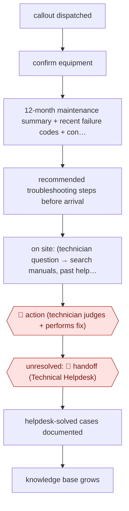

# Pre-arrival troubleshooting assist

`unplaced` (proposed: `ORG › FSV › TROUBLESHOOT`) · assist · evidence A · **draft: needs a reference example** ([how to add one](../../../CONTRIBUTING.md#1-add-an-example-run))

**Shape:** `callout dispatched → confirm equipment → 12-month maintenance summary + recent failure codes + connected-equipment data → recommended troubleshooting steps before arrival → on site: (technician question → search manuals, past helpdesk cases → cited steps) → 🛑 action (technician judges + performs fix) → unresolved: 🛑 handoff (Technical Helpdesk) → helpdesk-solved cases documented → knowledge base grows`
**How it differs:** AWF-0214 (dispatcher-overridden job assignment) decides which technician gets a job, with dispatchers sampling the board. This workflow starts after dispatch: it plans the diagnosis and guides one technician through the repair, and the technician decides each step (assist), with a handoff to a human helpdesk. The deliverable, user and checkpoints all differ. AWF-0108 (resident maintenance triage) triages resident requests into work orders and does not guide the repair.
**Variants:** `amazon-bedrock-claude` · `fluid-topics-rag`

<!-- shape diagram: generated by scripts/build_diagrams.py from `shape`; don't edit -->

<!-- end shape diagram -->

## Background

An elevator breaks and a technician drives to it, and the difference between a one-visit repair and a three-visit repair is usually decided before anyone arrives: whether the right part came along, whether the fault code was understood, whether the last twelve months of maintenance on that unit were read. A technician with twenty years of experience carries that in their head for the models they know and not for the rest. An assistant that reads the service history, decodes the failure code and proposes a diagnosis before the van moves changes the shape of the visit; on site, it answers the follow-up question — which parameter, which component, which manual page — from approved documentation and previously verified helpdesk cases, with a citation and sometimes the diagram. What it must not do is invent. The rule this deployment states plainly is that it cannot produce instructions that are not safe to use, so retrieval is restricted to approved manuals and verified cases, and the final judgement stays with the technician, who is the only person standing in front of the machine.

**Terms:**
- **callout**: a dispatched visit to a specific unit.
- **failure code**: the error code the unit reports, which narrows the fault but does not identify it.
- **connected equipment**: units streaming telemetry, which adds recent signals to the service history.
- **grounding**: restricting answers to approved sources so an answer can be checked.
- **LLM-as-judge**: a model checking another model's output, used here as a relevance and grounding gate before display.
- **escalation**: handing an unresolved case to the technical helpdesk.
- **knowledge base**: the verified record of solved cases, which is the asset that compounds.
- **speech-to-text**: dictating a question instead of typing it, wanted because hands are busy on site.

## Build it with an agent

**Form:** `skill`. One technician, one callout, questions asked in the field and answered from approved sources, with the technician deciding each action. Nothing accumulates per technician, and the deliverable is the plan plus the cited steps for this repair — the knowledge base it draws on and feeds belongs to the organisation, not to the run.

**You need:** the maintenance history and failure codes for the specific unit, because a generic answer to a specific machine is worse than none; the manuals and approved documentation as the only retrieval corpus, since the safety claim rests on that restriction; the verified helpdesk cases, which is where the practical knowledge lives; a grounding check before display, so a plausible step is not shown unless the source supports it; short answers, because a technician on a ladder will not read a page; and a handoff route to the technical helpdesk that captures what the helpdesk did, since that is what makes the next callout easier. The agent must not instruct outside approved documentation, and must not close a case: the technician decides whether the fault is fixed.

| Step | Built as |
|---|---|
| callout dispatched → confirm equipment | The run starts from the dispatch and confirms the unit identity first, because every later retrieval is keyed to the wrong machine if this is wrong. |
| 12-month maintenance summary + recent failure codes + connected-equipment data | A summary assembled from service records and telemetry, which is what turns a code into a likely cause rather than a lookup. |
| recommended troubleshooting steps before arrival | A short pre-visit plan with the part most likely needed, so the first visit has a chance of being the only visit. |
| on site: (technician question → search manuals, past helpdesk cases → cited steps) | Questions answered from approved documentation and verified cases only, each answer carrying its citation and often the diagram, with a relevance and grounding check before the technician sees it. |
| 🛑 action (technician judges + performs fix) | The technician decides and does the work; the assist has no actuation and no authority, which is also what keeps it out of the safety case. |
| unresolved: 🛑 handoff (Technical Helpdesk) → documented → knowledge base grows | Escalation to experienced engineers, whose solutions are written back as verified cases — the loop that makes the assistant better at this fleet over time. |

**Checkpoints:** `action`: the technician's judgement is the decision point, and the tool is built to inform it rather than to act, which is also why the safety claim is narrow enough to defend. `handoff`: unresolved work goes to a human helpdesk whose resolutions become new verified cases, so the escalation is not a dead end but the training signal.

**Since the sources:** Sources date from 2024 (a conference transcript) to 2026-08-19, plus an undated local story; none was re-opened on this pass, and no newer account of this deployment was found as of 2026-11. What has changed since is where the capability comes from. The field service management vendors have started shipping the same thing inside the platform: one announced in 2026-06 that its conversational layer would reach field technicians during the summer, answering questions about equipment manuals, diagnostics and parts mid-job. That does not change this entry's design, and it does change the build decision — a team choosing this workflow in 2026 is more likely configuring something that arrives with the dispatch system than assembling a retrieval stack, and the questions that decide success move accordingly: whether the corpus is restricted to approved documentation, whether answers come back short enough to use on a ladder, and whether helpdesk resolutions are written back as verified cases. The evidence here remains single-company and vendor-published, though the numbers are the kind a rollout produces rather than a pilot: available to about 15,000 technicians across 60 countries, and 80% of surveyed technicians satisfied.

*A design based on this entry's steps and the tool documentation as of 2026-11, not a reported run.*

## Steps

*As reported by the sources.*

1. A technician is dispatched on a callout. In the field service management tool, Technician Assistant first confirms the technician is working on the right equipment [[1]](#sources)[[3]](#sources).
2. It summarises the past 12 months of maintenance records and recent failure data for that unit, including connected-equipment (24/7 Connect) signals, and decodes unclear failure codes into likely root causes and fixes [[1]](#sources)[[3]](#sources).
3. Before the technician arrives, it generates recommended troubleshooting steps, so the technician can bring the right part [[1]](#sources)[[2]](#sources).
4. On site, the technician asks follow-up questions (component replacement, parameter settings, access). The assistant searches approved manuals, support documents and verified past helpdesk cases and returns short, cited steps, sometimes with images from manuals. Relevance and grounding are checked with an LLM-as-judge / guardrails before display [[1]](#sources)[[3]](#sources).
5. 🛑 **Action**: the technician decides what to do and does the work. KONE says the tool supports decision-making 'while always leaving the final judgment to them' [[1]](#sources).
6. 🛑 **Handoff**: if the problem is still unresolved, the technician escalates to the Technical Helpdesk (experienced field service engineers). Cases the helpdesk solves are documented and added to the knowledge base, which 'is growing on a daily basis' [[1]](#sources)[[3]](#sources).

**Output:** A troubleshooting plan and cited on-site guidance for one callout. Cases that stay unresolved go to the Technical Helpdesk, and every resolved helpdesk case becomes new knowledge for the next callout.
**Failure modes → guards:** Unsafe instructions → only approved documentation and verified cases are retrieved ('We cannot make instructions by AI that are not safe to use'). Long answers unusable on site → technician feedback shortened outputs. Hands busy → speech-to-text requested and on the roadmap. Terminology across markets → technicians refined translations.

## Public runs

Coverage as of 2026-11-13: **Strong**: a first-hand, detailed run that matches most of the shape. Collected and re-checked in [Fourth collection pass](../../../research/2026-11-fourth-pass.md).

- [KONE, How an AI tool helps service technicians stay one step ahead](https://www.kone.com/global/en/newsroom/stories/technician-assistant-ai-elevator-maintenance.html) (2026-08-19). Rollout to KONE's technicians; callout pre-diagnosis; the technician keeps the final judgment. "Already available to approximately 15,000 KONE service technicians across 60 countries"; "80% of surveyed technicians report being satisfied with the tool". *First-hand: yes; confidence: high.*
- [KONE Singapore, Living tall with Singapore's vertical nervous system](https://www.kone.sg/stories-and-references/stories/living-tall-with-singapore-vertical-nervous-system.aspx) (undated). Singapore/Malaysia pilots of Technician Assistant; early outcome on escalations. "a 6% decrease in call-out rates and 30% fewer escalated cases". *First-hand: yes; confidence: med.*

## Sources

1. KONE, How an AI tool helps service technicians stay one step ahead, 2026-08-19. https://www.kone.com/global/en/newsroom/stories/technician-assistant-ai-elevator-maintenance.html
2. KONE Singapore, Living tall with Singapore's vertical nervous system (undated). https://www.kone.sg/stories-and-references/stories/living-tall-with-singapore-vertical-nervous-system.aspx
3. KONE speaker at AWS re:Invent 2024, KONE Safeguards AI Applications with Amazon Bedrock Guardrails (third-party transcript). https://zenn.dev/kiiwami/articles/a332fc0b89657691?locale=en
4. AWS, Securing troubleshooting for 40,000 technicians using AWS with KONE (vendor case study, extra source). https://aws.amazon.com/solutions/case-studies/aws-ai-security-kone-case-study/
5. ServiceTitan, ServiceTitan's Max drives AI-powered growth for contractors (conversational field layer rolling out through summer 2026), 2026-06-24. https://www.servicetitan.com/press/servicetitans-max-drives-ai-powered-growth-for-contractors
