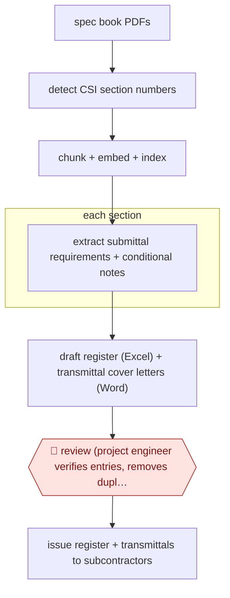

# Spec-to-submittal register

`unplaced` (proposed: `TEC › ENG › SUBMITTAL`) · checkpointed · evidence B · **draft: needs a reference example** ([how to add one](../../../CONTRIBUTING.md#1-add-an-example-run))

**Shape:** `spec book PDFs → detect CSI section numbers → chunk + embed + index → each section: extract submittal requirements + conditional notes → draft register (Excel) + transmittal cover letters (Word) → 🛑 review (project engineer verifies entries, removes duplicates, fills gaps) → issue register + transmittals to subcontractors`
**How it differs:** AWF-0151 First-pass submittal review checks a submittal a subcontractor has already sent against the spec and ends in architect disposition. This workflow produces the register of required submittals before any arrive; the deliverable is the log, the only checkpoint is the project engineer's verification, and no designer signs off.
**Variants:** `custom-rag-gpt-4o-mini` · `pype-autospecs`

<!-- shape diagram: generated by scripts/build_diagrams.py from `shape`; don't edit -->

<!-- end shape diagram -->

## Steps
1. Upload the project specification PDFs (800 to 1,500 pages) to the tool; text is extracted page by page [[1]](#sources).
2. Detect and segment specification sections with regular expressions tuned to CSI SectionFormat numbering (e.g. "07 21 00", "072100") so no manual markup is needed [[1]](#sources).
3. Split each section into overlapping chunks, embed them and store them in a vector index; scanned images and drawings are excluded [[1]](#sources).
4. For each section (or a user query such as "List all submittals under 07 21 00"), retrieve the relevant chunks and have the model return structured rows: section number, submittal requirement, conditional notes [[1]](#sources).
5. Export the rows to a transmittal-ready Excel register and Word cover letters [[1]](#sources). Commercial tools do the same step as a one-shot draft log [[2]](#sources).
6. 🛑 **Review**: the project engineer verifies extracted entries and corrects misclassifications and duplicate rows before the log is used; the authors report some entries "required expert review" [[1]](#sources). At Mortenson the time saved on drafting went into "more thorough reviews" [[2]](#sources).
7. Issue the verified register and transmittals to subcontractors; register then drives the submittal review cycle (see AWF-0151).

**Output:** A verified submittal register (Excel) plus transmittal cover letters, issued at project start and used to track every required submittal.
**Failure modes → guards:** Semantic drift creates duplicate entries from similar phrases in adjacent paragraphs; long clauses exceed the context window and drop secondary conditions → smaller chunks, adaptive prompts, and the project engineer's line-by-line review [1].

## Public runs

Coverage as of 2026-11-13: **Strong**: a first-hand, detailed run that matches most of the shape. Collected and re-checked in [Third collection pass](../../../research/2026-11-third-pass.md).

- [Kalasapudi et al., Frontiers in Built Environment](https://www.frontiersin.org/journals/built-environment/articles/10.3389/fbuil.2025.1713342/full) (2026-01-02). Peer-reviewed field test with a civil contractor; benchmark on ten 800–1,500 page specs; human review of entries kept. "Average end-to-end processing time was approximately 6–8 min per document"; "total computational costs under USD 0.10 per file". *First-hand: study; confidence: high.*
- [Pype, Mortenson case study](https://www.casestudies.com/company/pype/case-study/mortenson-scales-accuracy-quality-of-submittal-log-review-with-pype) (n.d.). Large GC drafts submittal log automatically, then reviews it; more submittal items found. "reduced the time spent creating a draft log by 99%, from 34 hours down to under 5 minutes". *First-hand: vendor; confidence: med.*

## Sources

1. Kalasapudi, Seelam, Ganupa, Tofferi (University of North Florida; Petticoat-Schmitt Civil Contractors), The overlooked frontier of AI in construction: conversational, document-native automation for administrative workflows, Frontiers in Built Environment, 2026-01-02. https://www.frontiersin.org/journals/built-environment/articles/10.3389/fbuil.2025.1713342/full
2. CaseStudies.com / Pype, Mortenson achieves 99% faster submittal log review with Pype AutoSpecs, n.d. https://www.casestudies.com/company/pype/case-study/mortenson-scales-accuracy-quality-of-submittal-log-review-with-pype
