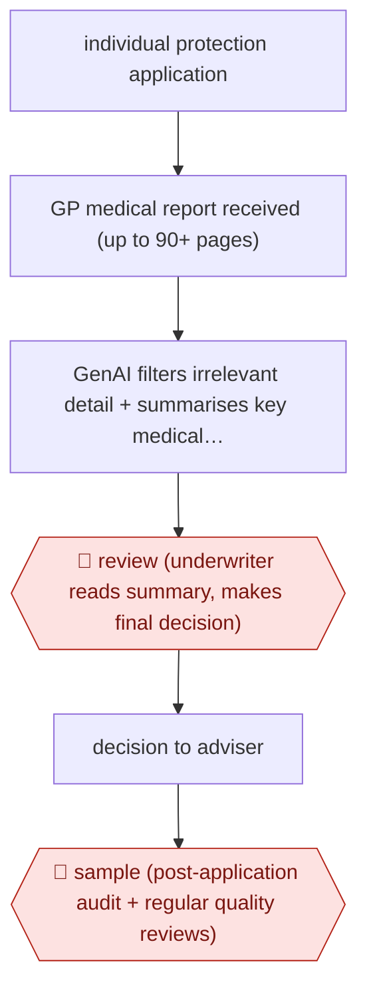

# Summarised GP-report underwriting

`unplaced` (proposed: `PRO › INS › UW`) · assist · evidence A · **draft: needs a reference example** ([how to add one](../../../CONTRIBUTING.md#1-add-an-example-run))

**Shape:** `individual protection application → GP medical report received (up to 90+ pages) → GenAI filters irrelevant detail + summarises key medical facts → 🛑 review (underwriter reads summary, makes final decision) → decision to adviser → 🛑 sample (post-application audit + regular quality reviews)`
**How it differs:** AWF-0149 triages broker submissions into a scored queue; AWF-0155 drafts a priced broker quote email. Here the agent condenses one applicant's medical evidence and the underwriter decides every case (assist): different deliverable (individual risk decision on medical evidence) and checkpoint. Enables the UW class (three distinct workflows).
**Variants:** `aviva-in-house` · `vitality-in-house`

<!-- shape diagram: generated by scripts/build_diagrams.py from `shape`; don't edit -->

<!-- end shape diagram -->

## Steps
1. An individual life, critical-illness or serious-illness application needs a GP medical report [[1]](#sources)[[2]](#sources)[[3]](#sources).
2. GenAI analyses the report, filters out irrelevant details and highlights key information, cutting reports 'sometimes over 90 pages' to concise summaries [[1]](#sources).
3. Rollout starts with lower-risk cases before wider use [[3]](#sources).
4. 🛑 **Review**: 'Aviva underwriters will review these summaries and make the final decision' [[1]](#sources).
5. 🛑 **Sample**: post-application auditing and 'regular quality reviews and ongoing oversight' [[2]](#sources)[[3]](#sources).

**Output:** Underwriting decision on the protection application, communicated to the adviser and customer.
**Failure modes → guards:** Summary drops a material condition → 18 months of testing, accuracy validation across conditions before extending to CI, start with lower-risk cases, ongoing quality reviews [1][2][3].

## Public runs

Coverage as of 2026-11-13: **Strong**: a first-hand, detailed run that matches most of the shape. Collected and re-checked in [Third collection pass](../../../research/2026-11-third-pass.md).

- [Aviva, AI underwriting tool launch](https://www.aviva.com/newsroom/news-and-research-overview/news-releases/2025/11/aviva-to-launch-groundbreaking-ai-underwriting-tool/) (2025-11-18). Life underwriting rollout after 18 months' testing; underwriter decides every case. "already processed 1,000 cases in an active test phase". *First-hand: yes; confidence: high.*
- [Aviva, extends to Critical Illness](https://www.aviva.com/newsroom/news-and-research-overview/news-releases/2026/03/aviva-extends-industry-first-ai-underwriting-tool-to-critical-illness-cover/) (2026-03-18). Extended to CI; also used for post-application auditing. "reduced the time underwriters spend reviewing each case by around half". *First-hand: yes; confidence: high.*
- [IFA Magazine, Vitality AI underwriting](https://ifamagazine.com/vitality-launches-ai-powered-underwriting-to-speed-up-adviser-case-decisions/) (2026-04-15). In-house LLM GP-report summaries, piloted 18 months, lower-risk cases first. CEO quoted. "an 81% reduction in GP report length". *First-hand: vendor; confidence: med.*

## Sources

1. Aviva plc, Aviva to launch groundbreaking AI Underwriting Tool, 2025-11-18. https://www.aviva.com/newsroom/news-and-research-overview/news-releases/2025/11/aviva-to-launch-groundbreaking-ai-underwriting-tool/
2. Aviva plc, Aviva extends industry-first AI underwriting tool to Critical Illness cover, 2026-03-18. https://www.aviva.com/newsroom/news-and-research-overview/news-releases/2026/03/aviva-extends-industry-first-ai-underwriting-tool-to-critical-illness-cover/
3. IFA Magazine (Bratley M.), Vitality launches AI powered underwriting to speed up adviser case decisions, 2026-04-15. https://ifamagazine.com/vitality-launches-ai-powered-underwriting-to-speed-up-adviser-case-decisions/
